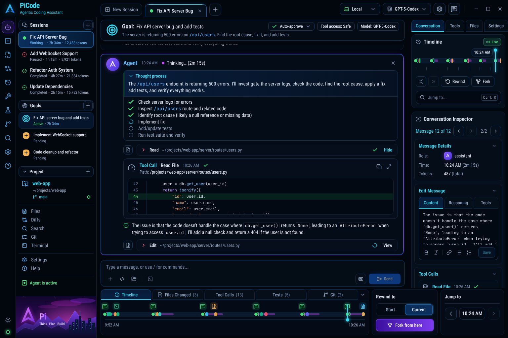
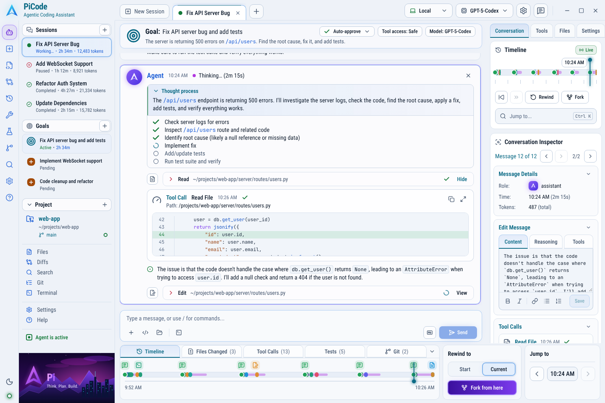
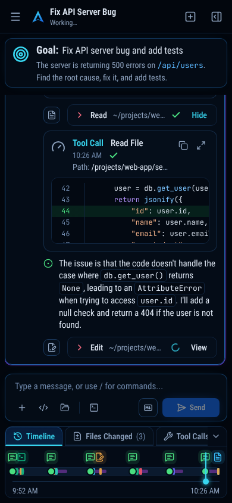
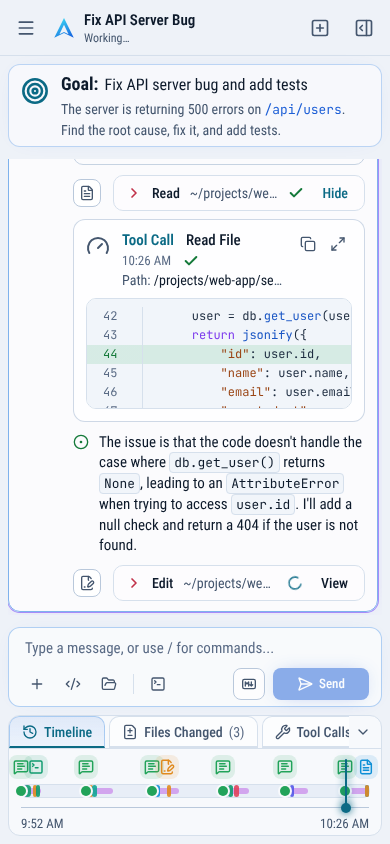

# PiCode UI

An agentic coding assistant interface with a **time-travel timeline**: every message and tool call
lands on a timeline you can scrub, inspect, rewind, or fork from. Built from the design in
[`docs/mockup.png`](docs/mockup.png).

| Desktop (dark)                                            | Desktop (light)                                             |
| --------------------------------------------------------- | ----------------------------------------------------------- |
|  |  |

| Phone (dark)                                                                       | Phone (light)                                                                        |
| ---------------------------------------------------------------------------------- | ------------------------------------------------------------------------------------ |
|  |  |

## Quick start

```bash
npm install
npm run dev        # http://localhost:5173
```

The app runs against an in-memory mock backend by default, so it works with no server. The demo
opens on the "Fix API Server Bug" session at 10:26 AM, exactly as in the design; about 15 seconds
later the simulated agent finishes the fix and runs the tests. Send a message (or type `/`) to
start a new agent turn.

| Script              | What it does                                 |
| ------------------- | -------------------------------------------- |
| `npm run dev`       | Vite dev server                              |
| `npm run build`     | Typecheck and build for production (`dist/`) |
| `npm run preview`   | Serve the production build                   |
| `npm run typecheck` | TypeScript project build, no emit            |
| `npm run lint`      | ESLint, including accessibility rules        |
| `npm test`          | Vitest unit, component and integration tests |
| `npm run format`    | Prettier (with Tailwind class sorting)       |
| `npm run check`     | Typecheck, lint, test and build in one go    |

To use a real backend, copy `.env.example` to `.env.local` and set `VITE_API_MODE=http` and
`VITE_API_URL`. The REST endpoints mirror the `ApiClient` interface in
[`src/api/client.ts`](src/api/client.ts).

## Tech stack

React 19 · TypeScript 6 · Vite 8 · Tailwind CSS 4 · TanStack React Query 5 · Zustand 5 ·
Vitest + Testing Library + axe-core · ESLint 10 (typescript-eslint, react-hooks, jsx-a11y-x) ·
Lucide icons · self-hosted Roboto Condensed and JetBrains Mono.

TypeScript is pinned to 6.0 because typescript-eslint supports `<6.1`. ESLint 9 is end-of-life,
so linting uses ESLint 10 with `eslint-plugin-jsx-a11y-x`, the maintained fork of jsx-a11y.

## How it is built

The full reasoning (mockup analysis, design tokens, component inventory, architecture,
responsive and accessibility strategy) is in
[`docs/IMPLEMENTATION_PLAN.md`](docs/IMPLEMENTATION_PLAN.md).

```
src/
  app/          App root, providers, React Query client
  api/          Domain types, ApiClient interface, HTTP client, React Query hooks
    mock/       Demo fixtures and the in-memory server with a simulated agent
  stores/       Zustand: UI preferences, workspace (tabs, playhead, drafts), toasts
  lib/          Pure logic: timeline, markdown, syntax highlighting, formatting, text editing
  hooks/        Media queries, shared clock, theme, hotkeys, click-outside
  components/
    ui/         Design-system primitives (Button, Tabs, Select, Menu, Dialog, Tooltip, …)
    brand/      Logo, avatars, synthwave hero
  features/
    shell/      Responsive layout, top bar, session tabs, icon rail, mobile header
    sidebar/    Sessions, goals, project, navigation
    session/    Session status, selects, active-session and playhead hooks
    conversation/  Goal header, messages, tool calls, code blocks, composer
    timeline/   Activity dock, timeline track, rewind / jump cards, fork and rewind
    inspector/  Timeline card, conversation inspector, tools / files / settings tabs
  styles/       Tailwind entry point and design tokens
```

### State

| State                                                         | Owner                                    |
| ------------------------------------------------------------- | ---------------------------------------- |
| Sessions, conversations, goals, project, models, environments | React Query (server state)               |
| Theme, inspector tab, activity tab, dock collapsed            | Zustand, persisted                       |
| Open tabs, active session, playhead, composer drafts          | Zustand, persisted (playhead in memory)  |
| Toasts, open sheets and dialogs                               | Zustand / component state                |
| Timeline, activity summaries, search results                  | Derived with pure functions in `src/lib` |

Mutations update the cache optimistically where the outcome is predictable (sending a message,
changing settings, switching message versions) and roll back on error. While the agent works,
the conversation polls every second and stops polling when the run ends.

### Time travel

The **playhead** is the selected message of a session. Clicking a message, scrubbing either
timeline, the arrows in the inspector and "Jump to" card, the `Ctrl/⌘ K` search and
`Alt ↑ / ↓` all move that one value, so every panel stays in sync. **Rewind** removes everything
after the playhead (with a confirmation that offers to fork instead); **Fork** copies the
conversation up to the playhead into a new session tab. Editing a message in the inspector saves a
new version; the version pager and Edit History switch between versions.

## Design system

Tokens live in [`src/styles/index.css`](src/styles/index.css) as semantic names (`bg-surface`,
`text-fg-muted`, `border-border-accent`, `bg-evt-edit`, …). Each points to a CSS variable whose
value depends on `data-theme` on `<html>`, so switching themes is one attribute. The theme follows
the system setting by default and can be set to light or dark in Settings or with the rail's
sun/moon button; an inline script applies the saved choice before first paint.

Primitives in [`src/components/ui`](src/components/ui) implement WAI-ARIA patterns: tabs with
roving focus, select-only combobox, menu button, radio-group segmented control, disclosure, slider
(timeline), and modal dialogs and sheets built on the native `<dialog>` element.

## Responsive layout

| Width       | Layout                                                                                    |
| ----------- | ----------------------------------------------------------------------------------------- |
| ≥ 1280px    | Full design: rail, sidebar, conversation, inspector, activity dock with Rewind/Jump cards |
| 1024–1279px | Inspector moves into a right-hand sheet                                                   |
| 768–1023px  | Sidebar moves into a left-hand sheet; the rail stays                                      |
| < 768px     | Phone header with menu and inspector sheets; goal settings live in Inspector → Settings   |

## Accessibility

- Landmarks (banner, primary and sidebar navigation, main, inspector), a skip link and one `h1`.
- Every control works from the keyboard, with visible focus rings in both themes.
- Status is never shown by colour alone; the agent's progress is announced through a live region.
- Body text meets WCAG AA contrast in both themes; motion respects `prefers-reduced-motion`.
- Checked automatically: `jsx-a11y-x` lint rules, an axe-core test on the rendered app, and axe
  runs in Chromium (dark, light, phone, dialogs and sheets) with no violations.

## Keyboard shortcuts

| Keys                    | Action                                                        |
| ----------------------- | ------------------------------------------------------------- |
| `Ctrl/⌘ K`              | Jump to a message or tool call                                |
| `Alt ↑` / `Alt ↓`       | Previous / next message                                       |
| `Enter` / `Shift Enter` | Send / new line                                               |
| `/`                     | Commands (`/test`, `/commit`, `/explain`, `/fork`, `/rewind`) |
| `?`                     | Help                                                          |
